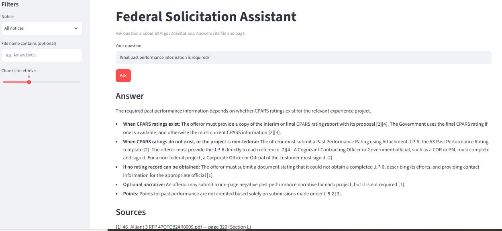
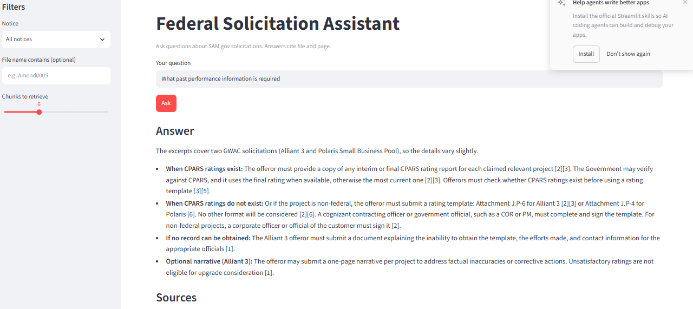
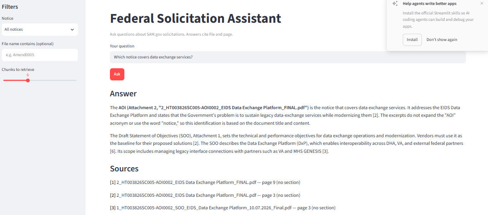
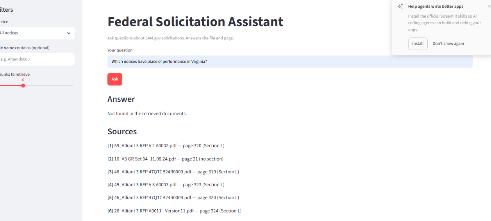
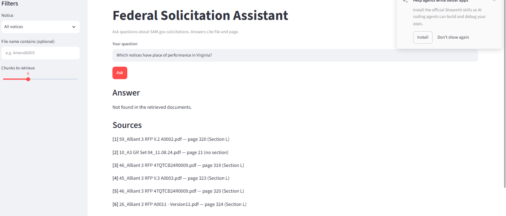

# Federal Solicitation Assistant (RAG)

Ask plain-English questions about SAM.gov contract opportunities and get answers
that cite the exact file and page. Built on a small, hand-picked dataset of five
real federal notices.

## Application Screenshots

### Main Application

### Polaris Past Performance

### Data Exchange

### Negative Answer — Not Found

### Place of Performance

## What it does

- Pulls opportunities and their attachments from the SAM.gov Get Opportunities API
- Extracts text from PDF, Word and Excel attachments, keeping page numbers
- Splits text into chunks, embeds them locally, and stores them in Chroma
- Answers questions with Claude using only the retrieved excerpts, with citations
- Replies "Not found in the retrieved documents" when the answer isn't there
- Answers structured questions (place of performance) straight from notice metadata

## Architecture

SAM.gov API -> data/raw -> parse.py -> chunk.py -> index.py (Chroma) -> rag.py -> Streamlit app

| Step | File | What it does |
|---|---|---|
| Ingest | src/ingest.py | Searches SAM.gov, saves metadata and attachments |
| Parse | src/parse.py | Text per page from PDF, DOCX, XLSX |
| Chunk | src/chunk.py | ~250-word chunks with section tags and metadata |
| Index | src/index.py | Local embeddings stored in Chroma |
| Answer | src/rag.py | Filtered retrieval, de-duplication, cited answer |
| Structured | src/place_lookup.py | Place-of-performance answers from metadata |
| UI | app.py | Streamlit chat with notice filter and sources |

## Dataset

- 5 notices: Alliant 3 GWAC, Polaris GWAC Small Business Pool, Sizing Technology
  Pilot, Marine Corps Education Command IT Support, Defense Health Agency EIDS
- 102 files, 5,479 pages of text, 11,357 chunks

## Evaluation

<N> ## Evaluation

Hand-written questions cover requirements, factual answers, amendments, cross-notice questions, structured questions, and questions whose answers are not found in the documents.

Retrieval is evaluated by checking whether a chunk from the expected file (and page, where specified) was returned. Answers are evaluated using keyword matching.

| Question type | Retrieval | Answers |
| :------------ | :-------- | :------ |
| requirements  | Not yet measured | Not yet measured |
| factual       | Not yet measured | Not yet measured |
| amendment     | Not yet measured | Not yet measured |
| cross         | Not yet measured | Not yet measured |
| structured    | n/a | Not yet measured |
| negative      | n/a | Not yet measured |

Baseline vs. after changes: Not yet measured.

Caveat: This is a small test set written during development. Keyword scoring is crude, so results should be treated as a development check, not a benchmark.

Baseline vs. after changes: <describe the change and the measured difference>.

Caveat: this is a small test set written while building the system, and
keyword scoring is crude, so treat the numbers as a development check, not a benchmark.

## What I learned and what failed

- **Near-identical amendment versions crowd out results.** Alliant 3 and Polaris
  have many versions of the same pages. I added contextual headers to each chunk
  and a de-duplication step that ignores digits and punctuation.
- **Structured facts don't belong in document search.** Set-aside type and place of
  performance live in API metadata, so I added a separate lookup for them.
- **Filtered retrieval checks are too easy.** Filtering to one file and checking
  results came from that file passes by construction. Page-level checks are stronger.
- **Unfiltered answers can blend notices.** An unfiltered past-performance answer
  mixed Alliant (J.P-6) and Polaris (J.P-4) forms. Selecting a notice avoids this.
- **Extra words in the question change retrieval.** Typed instructions got matched
  as search text. A query-rewriting step would help.
- **Section tags are approximate.** They work on RFP-style documents and show
  "no section" on others.
- **Metadata can be empty.** Two of five notices have no place of performance, so
  the app can only say it doesn't know.

## Run it

1. Install: `pip install -r requirements.txt`
2. Copy `.env.example` to `.env` and add your SAM.gov and Anthropic keys
3. Run in order: `python src/ingest.py`, `python src/parse.py`,
   `python src/chunk.py`, `python src/index.py`
4. Start the app: `streamlit run app.py`
5. Evaluate: `python tests/run_eval.py`

## Future work

- n8n workflow to run ingestion and indexing on a schedule and alert on new matches
- Power BI dashboard over notice metadata and evaluation results
- Query rewriting, re-ranking, and preferring the latest amendment version
- Fall back to searching document text for place names when metadata is empty
- OCR for scanned attachments